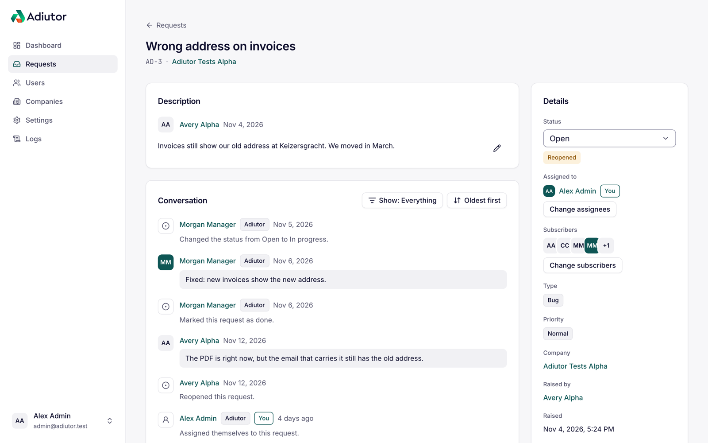
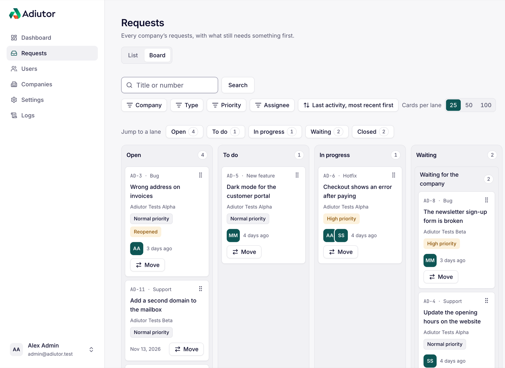

<h1>
  <picture>
    <source media="(prefers-color-scheme: dark)" srcset="public/brand/logo-on-dark.svg" />
    
  </picture>
</h1>

[](https://github.com/bastolen/adiutor/actions/workflows/ci.yml)
[](LICENSE)

**A shared service desk for IT service providers, agencies and consultancies.**

Adiutor gives the companies you support one place to raise requests and work them through with your
staff, without chasing emails. Each request is one conversation, from the first question to the
solution the company approves. Your staff see every company's requests; each company sees its own.

<picture>
  <source media="(prefers-color-scheme: dark)" srcset="docs/images/readme-request-dark.png" />
  
</picture>

## Why Adiutor

- **One conversation per request.** Replies, decisions and status changes stay together, and your
  staff follow every request on a list or a board.
- **Companies manage their own users.** Each company's Admins invite their colleagues as Admin,
  Client or Watcher, so you don't have to.
- **Solutions the company approves.** Send a reply as the solution, and the company approves or
  denies it on the request or straight from the email.
- **Secure by default.** Passkeys, two-step verification that every Admin and Manager must use,
  and an audit log of every change to sign-ins and access.
- **Accessible, in light and dark.** Built to WCAG 2.2 AA, and everything works with the keyboard
  alone.
- **Everyone's own language and time.** English, Dutch and Spanish, with every time shown in the
  reader's own time zone.

## Features

<picture>
  <source media="(prefers-color-scheme: dark)" srcset="docs/images/readme-board-dark.png" />
  
</picture>

- **Requests.** Companies raise requests, or the staff raise one for someone who asked by phone,
  and both sides work each one through in one conversation, with replies written in Markdown,
  mentions, and internal notes and priorities only the staff see. See
  [Requests](docs/requests.md).
- **Board and list.** All requests on a board with a lane per status, or as a list, with the same
  search and filters, across companies or on a company's page. See
  [The board](docs/requests.md#the-board).
- **Emails and solutions.** The people on a request get an email when someone replies or changes
  its status, with links that open it in one click. The staff can send a reply as the solution,
  which the company approves or denies. See [Emails](docs/requests.md#emails) and
  [Solutions](docs/requests.md#solutions).
- **Webhooks.** Send what happens to requests to your own systems as signed JSON, or to a chat
  channel as a message, per request type and event, retried when a receiver is down. See
  [Webhooks](docs/webhooks.md).
- **Companies, users and roles.** Staff add companies and invite each company's first Admin, who
  invites the rest. Users can belong to several companies, with a role in each (Admin, Client or
  Watcher), and the staff have roles of their own. There's no public sign-up. See
  [Companies, users and roles](docs/companies-and-roles.md).
- **Sign-in.** Email and password, passkeys, email links, and GitHub or Google accounts. See
  [Sign-in and accounts](docs/authentication.md).
- **Multi-factor authentication.** Authenticator apps, passkeys, email codes and backup codes,
  required for staff Admins and Managers and for company Admins. See
  [Multi-factor authentication](docs/mfa.md).
- **Security.** People see their recent activity and signed-in devices, and get an email when their
  access changes. A searchable audit log, rate limits and a strict Content Security Policy guard the
  rest. See [Security measures](docs/security-measures.md).
- **Sign in as a user.** Staff Admins, Managers and Support can see Adiutor the way a user does, to
  find out what isn't working for them. It lasts 30 minutes at most, and the user gets an email.
  See [Signing in as a user](docs/authentication.md#signing-in-as-a-user).
- **Background jobs.** Reminders, clean-ups and emails that can wait run in the background and are
  tried again when they fail. Staff Admins and Managers follow them under Logs → Jobs. See
  [Background jobs](docs/jobs.md).
- **Accessible, in light and dark mode.** Built to meet WCAG 2.2 AA in both modes, with full
  keyboard support. See [Design, accessibility and dark mode](docs/design.md).
- **Your brand.** Staff Admins choose an accent and a tint, and every page and email shows them in
  light and dark mode, adjusted where needed so text stays readable. Every text names the staff
  instead of Adiutor, with a small "Powered by Adiutor". See
  [Brand colours](docs/design.md#brand-colours).
- **Languages and time zones.** Staff Admins choose the languages Adiutor offers and its default;
  everyone can pick their own, and emails reach them in it. Times show in each person's own zone.
  See [Languages](docs/i18n.md).

## Status

Adiutor is in early development. Requests, with assignees, subscribers, emails and solutions the
company approves, are built, and so are companies, roles, invitations and sign-in security.
Attachments come next.

## Tech stack

- **App:** [Next.js](https://nextjs.org) 16 (App Router, Cache Components), React 19 and
  TypeScript, with [next-intl](https://next-intl.dev) for languages
- **Interface:** Tailwind CSS 4, [Radix UI](https://www.radix-ui.com) and
  [Lucide](https://lucide.dev) icons
- **Sign-in:** [Better Auth](https://www.better-auth.com), with passkeys, two-factor
  authentication, email links and GitHub and Google sign-in
- **Data:** PostgreSQL 18 with [Drizzle ORM](https://orm.drizzle.team), and Zod for validation
- **Email:** [React Email](https://react.email) templates sent over SMTP, with
  [Mailpit](https://mailpit.axllent.org) catching them in development
- **Tests:** Vitest with Testing Library, and Playwright with axe
- **Tooling:** pnpm, Docker Compose, ESLint (Airbnb style), Prettier, Stylelint, Husky and
  commitlint
- **Automation:** GitHub Actions, Release Please, Renovate and Dependabot

## Quick start

You need Node.js 26.13 or newer, the current LTS (see `.nvmrc`), pnpm (install it once with
`npm install --global pnpm`; it switches to the version the project pins by itself) and Docker (for
the local database and mail viewer).

```bash
pnpm install
cp .env.example .env    # then set BETTER_AUTH_SECRET and CRON_SECRET (openssl rand -base64 32 each)
pnpm services:up        # start PostgreSQL and Mailpit in Docker
pnpm db:migrate         # create the tables
pnpm dev
```

Open <http://localhost:3000>. On the first run it goes to `/setup`, where you choose the name users
see and create your Admin account. After that, sign in at `/auth`. Every email the app sends shows
up in Mailpit at <http://localhost:8025>.

To try every role, `pnpm db:seed --yes` replaces the local data with test companies and accounts
(`scripts/seed-dev.ts` lists them); add `--admin-mail you@adiutor.dev` to also get a staff Admin
you can sign in to with your own GitHub or Google account. [Local development](docs/development.md)
has more on the first run, the test accounts, starting over and every script.

### Running the tests

```bash
pnpm test                               # unit and component tests
pnpm test:integration                   # service tests against the test database
pnpm exec playwright install chromium   # once, for the end-to-end tests
pnpm test:e2e                           # end-to-end tests
pnpm lint && pnpm format:check && pnpm typecheck
pnpm ci:local                           # everything CI checks, in one go
```

The integration and end-to-end tests need `pnpm services:up` running. See [Testing](docs/testing.md).

## Documentation

The [docs](docs/README.md) go into detail, one topic each:

| Page                                                      | What it covers                                                                            |
| --------------------------------------------------------- | ----------------------------------------------------------------------------------------- |
| [Local development](docs/development.md)                  | First run, test accounts, starting over, every script                                     |
| [Where the code lives](docs/project-structure.md)         | The folders of the repository                                                             |
| [Testing](docs/testing.md)                                | Unit, integration and end-to-end tests                                                    |
| [Code style and tooling](docs/code-style.md)              | Linters, formatting, JSDoc, editor setup, Git hooks                                       |
| [CI, releases and dependencies](docs/ci-and-releases.md)  | CI, protecting `main`, security advisories, releases, dependency updates                  |
| [Companies, users and roles](docs/companies-and-roles.md) | Roles and permissions, staff screens, invitations                                         |
| [Requests](docs/requests.md)                              | Statuses, types and priorities, numbers, text, who may do what, the pages                 |
| [Sign-in and accounts](docs/authentication.md)            | Sign-in methods, sessions, account pages, security emails                                 |
| [Multi-factor authentication](docs/mfa.md)                | Second steps, who needs them, confirming sessions                                         |
| [Security measures](docs/security-measures.md)            | Audit log, rate limits, tokens, names, lock order, headers, CSP                           |
| [Webhooks](docs/webhooks.md)                              | Who sets them up, addresses, secrets, verifying a delivery                                |
| [Email](docs/email.md)                                    | Templates, previews, Mailpit, how emails are sent                                         |
| [Background jobs](docs/jobs.md)                           | The tick, recurring and queued jobs, the Jobs page, commands, adding a job                |
| [Design, accessibility and dark mode](docs/design.md)     | Components, tables, colours, keyboard support, dark mode, brand                           |
| [Languages](docs/i18n.md)                                 | Choosing a language, translation catalogues, time zones, formatting, checks               |
| [Deploying and running](docs/deploying.md)                | Install and upgrade, Vercel, Docker, server setup, client IP, jobs, webhooks, logs, leaks |
| [Decision records](docs/decisions/README.md)              | Why Adiutor works the way it does, one decision per page                                  |

## Contributing

Contributions are welcome. [CONTRIBUTING.md](CONTRIBUTING.md) explains how to set up the project,
the code style and how to get a change merged. Please follow the
[Code of Conduct](CODE_OF_CONDUCT.md).

## Security

Please don't report security issues in public issues or pull requests. Report them privately
through the repository's **Security** tab (**Report a vulnerability**), or, without a GitHub
account, by email to **adiutor@bastolen.nl**. [SECURITY.md](SECURITY.md) has the details.

## License

The code is released under the [MIT License](LICENSE).

The MIT License covers the source code only. The Adiutor name, logo and other brand assets
(including the files listed in [NOTICE](NOTICE)) are not covered by it and may not be used to
represent other projects or products without permission.

The fonts Adiutor ships, [Inter](https://github.com/rsms/inter) and
[JetBrains Mono](https://github.com/JetBrains/JetBrainsMono), are under the SIL Open Font License
1.1 (see `LICENSES/`).
